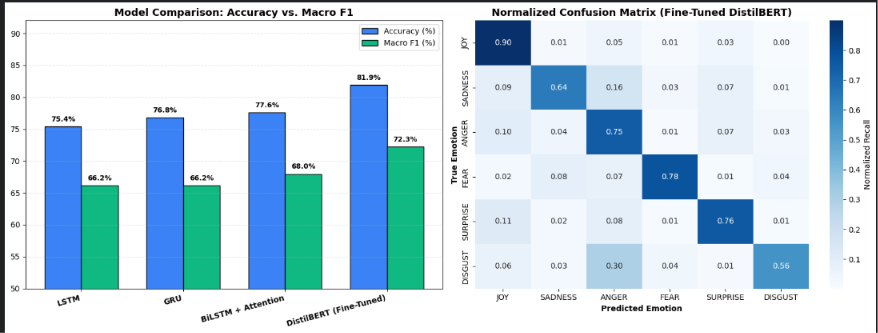
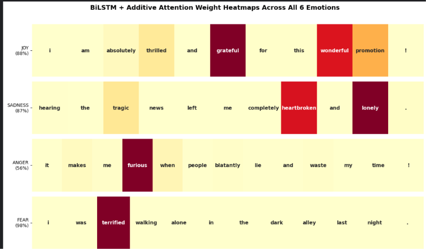
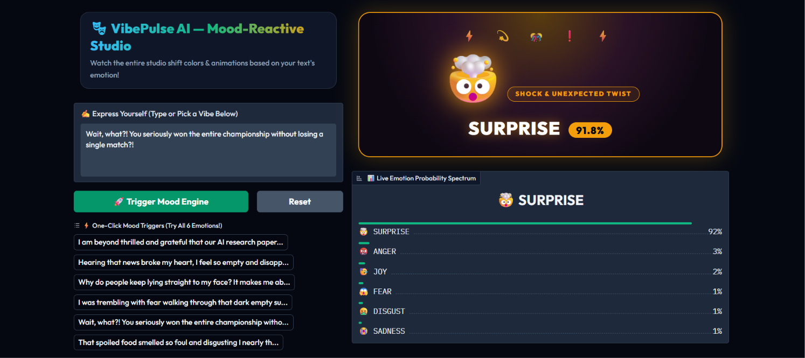

# 🎭 VibePulse AI — Emotion Classification & Attention Explainability Studio


An end-to-end **Multi-Class Emotion Classification & Explainable AI (XAI)** suite built on Google's **GoEmotions** dataset mapped to **Ekman's 6 Core Emotions** (`Joy`, `Sadness`, `Anger`, `Fear`, `Surprise`, `Disgust`). The project systematically benchmarks custom recurrent architectures—**LSTM**, **GRU**, and **BiLSTM + Additive Self-Attention** initialized with **FastText 300d** subword vectors—against a **Fine-Tuned `distilbert-base-uncased`** Transformer trained via the `HuggingFace Trainer API`, deployed inside an interactive mood-reactive **Gradio Studio**.

---

## 📊 Experimental Benchmark (GoEmotions 6-Class Test Set)

| Architecture | Word Representation | Test Accuracy | Macro F1-Score |
| :--- | :--- | :---: | :---: |
| **1. Unidirectional LSTM** | FastText 300d + SpatialDropout | 75.39% | 0.6618 |
| **2. Unidirectional GRU** | FastText 300d + SpatialDropout | 76.80% | 0.6619 |
| **3. BiLSTM + Additive Attention** | FastText 300d + Attention + MaxPool | 77.59% | 0.6795 |
| **4. Fine-Tuned DistilBERT** | Contextual WordPiece Self-Attention | **81.94%** | **0.7226** |

### Per-Class Performance — Fine-Tuned DistilBERT

| Emotion Class | Precision | Recall | F1-Score | Support |
| :--- | :---: | :---: | :---: | :---: |
| **😄 JOY** | 0.9183 | 0.8993 | **0.9087** | 1,937 |
| **😲 SURPRISE** | 0.7533 | 0.7561 | **0.7547** | 533 |
| **😨 FEAR** | 0.6735 | 0.7765 | **0.7213** | 85 |
| **😡 ANGER** | 0.6811 | 0.7471 | **0.7126** | 609 |
| **😢 SADNESS** | 0.7235 | 0.6409 | **0.6797** | 298 |
| **🤢 DISGUST** | 0.5584 | 0.5584 | **0.5584** | 77 |

---

## 📈 Benchmark & Attention Visualization





---

## 🚀 Quickstart

```bash
git clone [https://github.com/ZiadWalid44/Emotion-Classification-Attention-Studio.git](https://github.com/ZiadWalid44/Emotion-Classification-Attention-Studio.git)
cd Emotion-Classification-Attention-Studio
pip install -r requirements.txt
python app.py